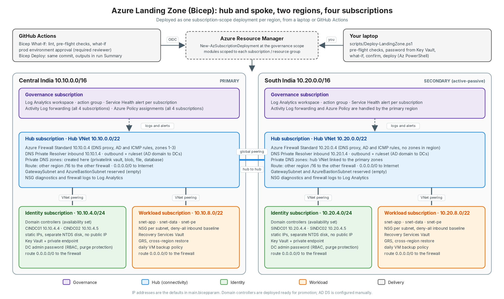

# Azure Landing Zone - Bicep

[](https://github.com/hitulgala/azure-landing-zone-bicep/actions/workflows/bicep-whatif.yml)
[](https://github.com/hitulgala/azure-landing-zone-bicep/actions/workflows/bicep-deploy.yml)



Hub-and-spoke Azure landing zone for **Central India (primary)** and **South India (secondary, active-passive)** across four subscriptions: Governance, Hub, Identity and Workload. It is written in **Bicep** and deployed either from your laptop or through a **GitHub Actions pipeline** in which every change is previewed with what-if on a pull request, reviewed, approved, and only then deployed.

**Design rule:** every deployment value lives in `main.bicepparam` (names, address spaces, NSG rules, routes, firewall rules, VM settings, e-mail addresses). The `.bicep` files only wire modules together. The only exceptions are your **subscription IDs** and the **domain controller password**, which never touch Git (see [Configuration](#configuration)).

## What it builds
| Subscription | Resources |
|--------------|-----------|
| Governance | Resource group, Log Analytics workspace, action group, Activity Log forwarding (primary only), Azure Policy assignments (primary only) |
| Hub | VNet, Azure Firewall Standard with policy and rules (DNS proxy), DNS Private Resolver with forwarding ruleset, Private DNS zones (created in primary, linked from secondary), cross-region routing, hub-to-hub peering (secondary), reserved Gateway and Bastion subnets |
| Identity | VNet, NSGs, route table, Key Vault with private endpoint holding the DC admin password, domain controller VMs (count, size and placement set in `main.bicepparam`). **No AD DS promotion.** |
| Workload | VNet, NSGs, route table, Recovery Services Vault with a daily VM backup policy. **No VMs.** |
| All four | A Service Health alert per subscription, routed to the governance action group |

## Repository layout
```
.github/workflows/
  bicep-whatif.yml         lint (format, lint, build) -> pre-flight checks -> what-if (run Summary)
  bicep-deploy.yml         waits for approval on 'prod', then deploys the previewed commit
modules/                   9 single-purpose modules + types.bicep (see modules/README.md)
primary-centralindia/      primary region stack: main.bicep (wiring) + main.bicepparam (values)
secondary-southindia/      secondary region stack (published in a later release)
scripts/
  Deploy-LandingZone.ps1   pre-flight checks, DC password handling, what-if / deploy
  ids.local.ps1.example    template for your subscription IDs (copy to ids.local.ps1)
docs/                      local deployment, CI/CD, deployment and DR, decisions, diagrams
bicepconfig.json           linter rules (secrets and unused code are errors)
CONTRIBUTING.md            branch, pull request and commit conventions
SECURITY.md, CHANGELOG.md, LICENSE
```

## Quick start

### Option A - From your laptop (start here if you are learning)
```powershell
Copy-Item scripts/ids.local.ps1.example scripts/ids.local.ps1   # fill in your tenant and subscription IDs
# edit primary-centralindia/main.bicepparam: search for '<--'

./scripts/Deploy-LandingZone.ps1 -Stack primary-centralindia                 # pre-flight checks + what-if, no changes
./scripts/Deploy-LandingZone.ps1 -Stack primary-centralindia -Mode Deploy    # what-if, confirm, deploy
```
The step-by-step guide, including prerequisites, permissions, verification, pausing costs and teardown, is in [docs/local-deployment.md](docs/local-deployment.md).

### Option B - GitHub Actions
1. Click **Use this template** (or fork) to create your own repository.
2. Create an Entra ID application with **federated credentials (OIDC)** and give it **Contributor**, **User Access Administrator** and **Resource Policy Contributor** on each subscription ([docs/cicd-pipeline.md](docs/cicd-pipeline.md#1-deployment-identity-oidc)).
3. Add the repository **variables** listed in [docs/cicd-pipeline.md](docs/cicd-pipeline.md#2-github-variables). No secrets are needed.
4. Create the **`prod`** environment with yourself as required reviewer, deployable from `main` only.
5. Edit `main.bicepparam` (search for `<--`), push to `main`, read the what-if, then approve **Bicep Deploy**.

> On GitHub Free, environment approvals work in **public** repositories only.

## Configuration
| File | Committed | Contains |
|------|-----------|----------|
| `main.bicepparam` | Yes | Every deployment value except IDs and the password |
| `scripts/ids.local.ps1.example` | Yes | Placeholder template for the IDs |
| `scripts/ids.local.ps1` | **No** (git-ignored) | Your tenant and subscription IDs, for local runs |

`main.bicepparam` reads the subscription IDs with `readEnvironmentVariable()`. Locally, the deploy script loads them from `ids.local.ps1`; in the pipeline they come from repository variables. The **DC admin password** is generated by the deploy script on the first run, stored in Key Vault by the deployment, and read back from Key Vault on every later run.

**Single subscription?** Use the same subscription ID for all four values. Everything then lands in one subscription, and the Service Health alert is created once.

## Mandatory tags and Azure Policy
`mandatoryTagNames` lists the tags every resource must carry (`environment`, `workload`, `owner`, `cost_center`, `managed_by`).
1. The deploy script stops before deploying if `tags` lacks a value for any mandatory name.
2. `tags` is a required input of every module and is applied to every taggable resource.
3. Azure Policy, assigned at subscription scope by the **primary** stack only, requires the tags on resource groups and makes resources inherit them.

Other policies (allowed locations, allowed VM sizes, no public IPs on NICs) start in **audit mode** (`enforce: false`). Review **Policy → Compliance** in the portal, then enforce. See [docs/deployment-and-dr.md](docs/deployment-and-dr.md#azure-policy).

## Documentation
| Document | Read it for |
|----------|-------------|
| [docs/local-deployment.md](docs/local-deployment.md) | Deploying, verifying and removing the landing zone from your own laptop, step by step |
| [docs/architecture-diagrams.md](docs/architecture-diagrams.md) | Overview, network, DNS, identity, deployment scopes, pipeline and failure-scenario diagrams |
| [docs/cicd-pipeline.md](docs/cicd-pipeline.md) | How the pipeline works, OIDC setup, approvals, recovery, troubleshooting |
| [docs/deployment-and-dr.md](docs/deployment-and-dr.md) | Permissions, deployment order, post-deployment steps, DR |
| [docs/decisions.md](docs/decisions.md) | Why the design is the way it is |
| [modules/README.md](modules/README.md) | What each module builds |
| [CONTRIBUTING.md](CONTRIBUTING.md) | How to propose a change |
| [SECURITY.md](SECURITY.md) | How to report a vulnerability, known trade-offs |
| [CHANGELOG.md](CHANGELOG.md) | Change history |

## IP plan
| Region | Supernet | Hub | Identity | Workload |
|--------|----------|-----|----------|----------|
| Central India | 10.10.0.0/16 | 10.10.0.0/22 | 10.10.4.0/24 | 10.10.8.0/22 |
| South India   | 10.20.0.0/16 | 10.20.0.0/22 | 10.20.4.0/24 | 10.20.8.0/22 |

## Status and roadmap
| Item | Status |
|------|--------|
| Primary region deployed from a laptop and through the pipeline | Done |
| Pull request what-if, approval-gated deploy, OIDC (no client secret) | Done |
| Secondary region stack published and deployed | Planned |
| Branch ruleset with required status checks | Planned |
| Deployment Stacks (lifecycle management, deny settings) | Planned |
| PSRule for Azure in the pipeline | Planned |
| Self-hosted runner inside the VNet (private Key Vault access) | Planned |

## License
[MIT](LICENSE)
