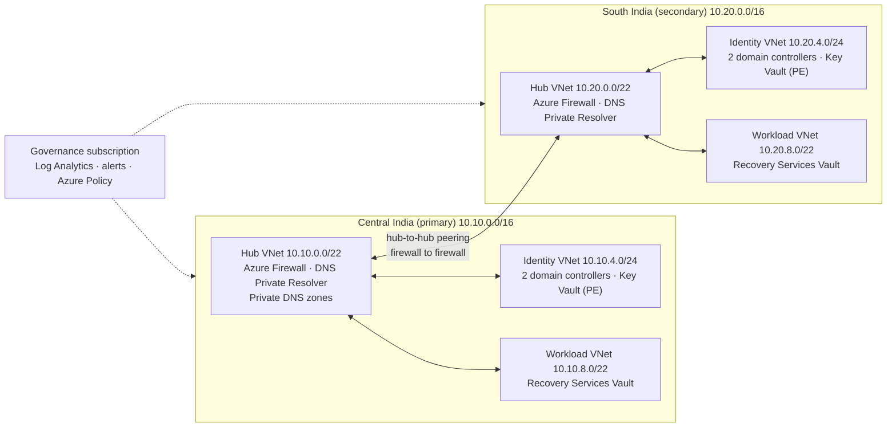
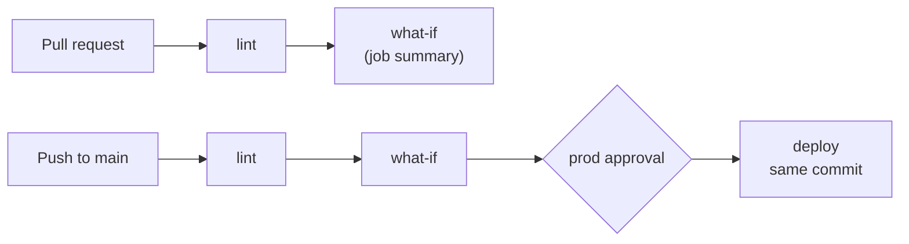

# Azure Landing Zone — Bicep

[](https://github.com/hitulgala/azure-landing-zone-bicep/actions/workflows/bicep-whatif.yml)
[](https://github.com/hitulgala/azure-landing-zone-bicep/actions/workflows/bicep-deploy.yml)

A two-region, four-subscription **hub-and-spoke Azure landing zone** written in Bicep and deployed through GitHub Actions with OIDC and an approval gate.

It is the Bicep twin of [azure-landing-zone-terraform](https://github.com/hitulgala/azure-landing-zone-terraform): the same architecture, module boundaries and values, built a second time to compare the two tools on a real design rather than a toy example.

---

## Architecture



| Subscription | What it holds (per region) |
|---|---|
| **Governance** | Log Analytics workspace, action group, Activity Log forwarding (primary), Azure Policy assignments for all four subscriptions (primary) |
| **Hub** | Hub VNet, Azure Firewall + policy (DNS proxy, AD and ICMP rules), DNS Private Resolver + forwarding ruleset, Private DNS zones (created by the primary, linked by the secondary), reserved Gateway and Bastion subnets |
| **Identity** | Identity VNet, two domain-controller-ready Windows Server VMs (static IPs, separate NTDS disk, availability set), Key Vault with private endpoint holding the DC admin password |
| **Workload** | Workload VNet (app, data and private-endpoint subnets), Recovery Services Vault with a daily VM backup policy |
| **All four** | A Service Health alert per subscription, all routed to the governance action group |

**Traffic and name resolution:** spoke subnets send everything (`0.0.0.0/0`) to the regional firewall, and the firewalls route the other region's range to each other across the hub-to-hub peering. Spokes use the firewall as DNS (DNS proxy); the firewall forwards to the DNS Private Resolver, which answers from the Private DNS zones or forwards the AD domain to the domain controllers. Every NSG has a deny-all inbound baseline.

> Domain controllers are deployed **ready for promotion**; AD DS itself is configured manually. Internet egress (for example Windows Update) needs firewall application rules, which are deliberately not included.

---

## Repository layout

```
.github/workflows/
  bicep-whatif.yml       lint + format + what-if on PRs and pushes   (= terraform plan)
  bicep-deploy.yml       approval-gated deployment                   (= terraform apply)
modules/                 9 single-purpose modules + types.bicep (shared schemas)
primary-centralindia/    main.bicep (wiring only) + main.bicepparam (all values)
secondary-southindia/    main.bicep (wiring only) + main.bicepparam (all values)
scripts/
  Deploy-LandingZone.ps1 pre-flight checks, password handling, what-if / deploy
  ids.local.ps1.example  template for your local subscription IDs (git-ignored copy)
bicepconfig.json         linter rules (secrets and unused code are errors)
```

**Design rules**

* Every deployment value lives in `main.bicepparam`. The `.bicep` files only wire modules together.
* Modules contain no subscription logic and no hard-coded values; the stack decides each module's scope.
* Subscription IDs and the DC password never touch Git: IDs come from environment variables (GitHub variables in CI), and the password is generated once and kept in Key Vault.
* Policy is subscription-wide, so only the primary stack assigns it.

---

## CI/CD pipeline



| Workflow | Trigger | What it does |
|---|---|---|
| **Bicep What-If** | PR to `main`, push to `main`, manual | `lint` job (no Azure access): `bicep format` check, `bicep lint`, build both stacks. `what-if` job: pre-flight checks and a what-if, published to the job summary |
| **Bicep Deploy** | After a successful What-If on a push to `main`, or manual | Waits for approval on the `prod` environment, then deploys the previewed commit and publishes the outputs |

* **Authentication:** OpenID Connect. GitHub issues a short-lived token per job and Azure trusts it through federated credentials, so **no client secret exists anywhere**.
* **Approval:** the `prod` environment requires a reviewer and only accepts `main`.
* **No saved plan:** a what-if is a prediction, not an artifact. The deploy job deploys the same commit, and ARM re-evaluates at deploy time. Deployments are idempotent, so re-running is always safe.

---

## Getting started

### Prerequisites

* PowerShell 7.2+ and Az PowerShell (`Install-Module Az -Scope CurrentUser`)
* Bicep CLI on `PATH`: `winget install -e --id Microsoft.Bicep`
* On each of the four subscriptions: **Contributor**, **User Access Administrator** and **Resource Policy Contributor** (or Owner)

### Configure

1. Copy `scripts/ids.local.ps1.example` to `scripts/ids.local.ps1` and add your tenant and subscription IDs.
2. In both `main.bicepparam` files, search for `<--` and change at least the **Key Vault names** (globally unique), the **alert e-mail**, the **owner / cost centre tags** and the **AD domain name**.

### Deploy from your laptop

```powershell
./scripts/Deploy-LandingZone.ps1 -Stack primary-centralindia                 # pre-flight checks + what-if
./scripts/Deploy-LandingZone.ps1 -Stack primary-centralindia -Mode Deploy    # what-if, confirm, deploy
./scripts/Deploy-LandingZone.ps1 -Stack secondary-southindia -Mode Deploy    # always after the primary
```

The script compiles the parameters, runs the cross-field checks (mandatory tags, NSG and route-table references, DC placement, policy definitions…), resolves the DC password (reads it back from Key Vault, or generates it on the first run) and deploys at the governance subscription scope. Expect 30–45 minutes for a first deployment.

### Deploy through GitHub Actions

Create an Entra ID application with federated credentials for this repository, give it the roles above, and set these repository variables:

| Variable | Value |
|---|---|
| `AZURE_CLIENT_ID` | Application (client) ID of the deployment identity |
| `AZURE_TENANT_ID` | Entra tenant ID |
| `ALZ_SUB_GOVERNANCE`, `ALZ_SUB_HUB`, `ALZ_SUB_IDENTITY`, `ALZ_SUB_WORKLOAD` | Subscription IDs |
| `BICEP_VERSION` | Bicep CLI release tag, e.g. `v0.38.33` |

Then create a `prod` environment with a required reviewer. Open a pull request to see a what-if; merge it to deploy.

---

## Terraform vs Bicep

| Concern | Terraform repo | This repo |
|---|---|---|
| Multiple subscriptions | 4 aliased providers | Module `scope: subscription()` / `resourceGroup(subId, rg)` |
| State | Remote state in Azure Storage, bootstrap script | None: Azure Resource Manager is the source of truth |
| Preview | `terraform plan`, saved and applied exactly | What-if: a prediction; deploy re-evaluates |
| Values | `terraform.tfvars` | `main.bicepparam` (same structure, camelCase keys) |
| Schemas and validation | `variables.tf` types + `validation` blocks | `types.bicep` + pre-flight checks in the deploy script |
| DC password | `random_password` | Generated by the deploy script, stored in Key Vault |
| Policy definition lookup | `data` source by display name | Display name → GUID map in the parameters |
| Secondary reads the primary hub | `data` sources | `primaryHub` parameter |
| Firewall IP check | `check` block | `firewallIpMatchesExpected` output, warned by the script |
| CI authentication | Service principal secret | OIDC federated credentials |
| Removing resources | Automatic (state diff) | Manual (or Deployment Stacks) |

**Takeaways:** Bicep removes the whole state problem (no backend, no locks, no secrets stored in state) and supports new Azure features on day one. Terraform gives a binding plan, automatic deletion of removed resources and built-in cross-field validation, which lives in the deploy script here.

---

## Cost

Azure Firewall Standard is the main cost driver, followed by the DNS resolver endpoints and the domain controller VMs. Charges start as soon as a stack is deployed. Between learning sessions, deallocate the firewall and stop the VMs, or delete the resource groups.

## Roadmap

- [ ] Detailed docs: architecture decisions, deployment and DR guide, CI/CD guide
- [ ] Branch ruleset: required PR and status checks on `main`
- [ ] Deployment Stacks for lifecycle management and deny settings
- [ ] PSRule for Azure in the pipeline (Well-Architected checks)
- [ ] Secondary region deployed through the pipeline

## Related

* [azure-landing-zone-terraform](https://github.com/hitulgala/azure-landing-zone-terraform): the same landing zone in Terraform
